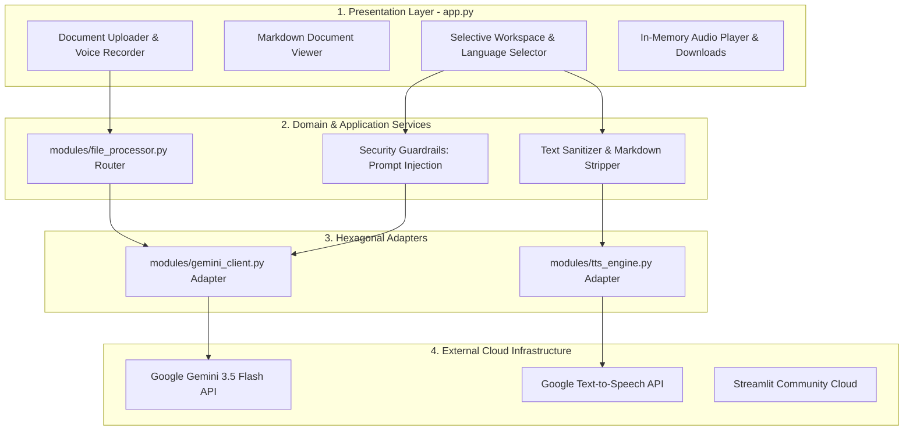

# Globetrotter: System Architecture & Engineering Design

This document details the architectural principles, component structure, data flow, and hexagonal boundaries implemented in the **Globetrotter** Translation and Text-to-Speech system.

---

## 1. High-Level Architecture Overview

The system is designed following strict **Layered Architecture** and **Hexagonal (Ports & Adapters)** principles to ensure high cohesion, low coupling, stateless execution, and fail-fast predictability.

> **Excalidraw Source:** The raw editable vector diagram is preserved in [`architecture.excalidraw`](architecture.excalidraw), which can be opened and edited directly on [Excalidraw.com](https://excalidraw.com) or within IDE Excalidraw plugins.

---

## 2. Layered Responsibilities

### Layer 1: Presentation & UI Layer (`app.py`)
- **Framework**: Streamlit
- **Responsibilities**:
  - Render user interface widgets (file uploader, audio recorder, language dropdown, text area, audio player).
  - Manage session state (`doc_viewer`, `translation_result`, `audio_bytes`, `gemini_client`).
  - Strict UI-only orchestration: **No file parsing, no Markdown stripping, and no direct database/SDK calls**.

### Layer 2: Domain & Service Layer
- **Modules**:
  - [`modules/file_processor.py`](modules/file_processor.py): Format-specific routing for PDF, TXT, CSV, and Excel. Translates DataFrame string columns cell-by-cell while preserving numeric integrity.
  - Guardrails in [`modules/gemini_client.py`](modules/gemini_client.py): Intercepts prompt injection and malicious queries before submitting payloads to the LLM.
  - Text Normalization & Sanitization in [`modules/tts_engine.py`](modules/tts_engine.py): Strips Markdown headers, asterisks, bullet points, and HTML tags via `BeautifulSoup` and `markdown` before audio synthesis so TTS does not pronounce formatting symbols.

### Layer 3: Hexagonal Adapters & I/O Boundaries
- **Adapters**:
  - `GeminiClient`: Encapsulates Google GenAI SDK. Enforces structured JSON responses (`detected_language`, `translation`, `transcription`), handles PDF vision bytes, and wraps external network exceptions into domain exceptions (`GeminiAPIError`, `JSONParseError`).
  - `TTSEngine`: Wraps Google Text-to-Speech (`gTTS`). Accepts clean text strings, streams audio bytes directly into a memory buffer (`io.BytesIO`), and returns raw MP3 bytes without touching the physical file system.

### Layer 4: External Services & Deployment
- **Google Gemini API**: Powers LLM translation, source language detection, voice transcription, and document OCR.
- **Google TTS Endpoint**: Synthesizes speech into standard MP3 audio streams.
- **Streamlit Community Cloud**: Fully stateless serverless execution environment.

---

## 3. Adherence to Universal Engineering Principles

1. **Zero Absolute Paths**: All file paths and resources are resolved dynamically using `Path(__file__).resolve().parent`.
2. **Zero Hardcoding & Fail-Fast Configuration**:
   - Secrets reside exclusively in `.env` (with `.env.example` committed).
   - Operational parameters (`model_name`, `languages`, `tts.engines`) reside in `config.json`.
   - Missing configuration parameters raise explicit `KeyError` or `ValueError` immediately upon application startup; no silent fallback defaults are tolerated.
3. **Stateless In-Memory I/O**: Audio files are managed strictly through in-memory byte streams (`io.BytesIO`). This removes disk write dependencies and guarantees compatibility with ephemeral cloud containers (Streamlit Cloud, Heroku, Docker).
4. **DRY & Dead Code Elimination**: All abandoned methods (e.g. deprecated filesystem cleanup) and unused dependencies (`PyPDF2`, `pdfplumber`, `starlette`) have been audited and removed.
5. **Closed-Loop Verification**: Comprehensive `pytest` test suite with 100% passing unit and integration tests across all modules.

