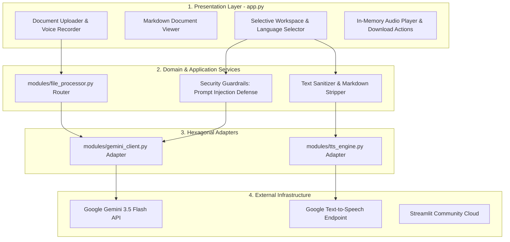

# Globetrotter: Selective Translation & TTS
**Generative AI and ML Capstone Project**  
*Edureka & Illinois Institute of Technology*

---

## Overview

The **Globetrotter** application is a production-grade, interactive web system built with **Streamlit** that enables users to translate text across multiple languages, synthesize the translated text into spoken audio, and download the resulting MP3 audio file. 

The system leverages **Google's Gemini 3.5 Flash API** for context-aware language translation, audio transcription, and layout-preserving PDF extraction, paired with **Google Text-to-Speech (gTTS)** for speech synthesis. The backend is engineered according to **Clean Hexagonal Architecture**, **Zero Absolute Paths**, and **Fail-Fast Configuration** standards.

---

## System Architecture

The application is structured in four decoupled layers ensuring single responsibility and stateless cloud execution:


> **Excalidraw Editable Diagram:** The editable vector diagram is stored in [`architecture.excalidraw`](architecture.excalidraw). Detailed architectural decisions are documented in [`ARCHITECTURE.md`](ARCHITECTURE.md).



---

## Core Features

1. **Direct Text & Selective Processing:** Type or paste arbitrary text into the workspace, or selectively copy extracted document sections.
2. **Multi-Format Document Upload:** Seamless ingestion of **PDF**, **TXT**, **CSV**, and **Excel (`.xlsx`, `.xls`)** files.
3. **Multimodal Document Understanding:** PDFs are processed via Gemini's multimodal vision endpoint, perfectly preserving Markdown headers, lists, and tabular formatting.
4. **Voice Recording & Transcription:** Built-in microphone audio recorder capturing speech directly in the browser, transcribed via Gemini.
5. **Context-Aware Translation & Language Detection:** Automatically identifies source languages and returns accurate, culturally coherent translations into 13+ languages.
6. **In-Memory Audio Generation (Stateless TTS):** Synthesizes high-fidelity MP3 audio streams entirely within memory buffers (`io.BytesIO`), bypassing ephemeral local disk restrictions on serverless platforms.
7. **Security Guardrails:** Built-in prompt injection filters intercepting adversarial instructions before submission to the LLM.

---

## Installation & Local Setup

### Prerequisites
- Python 3.12 (specified in `.python-version`)

### Steps

1. **Set up a Virtual Environment:**
   - **Windows (PowerShell):**
     ```powershell
     python -m venv .venv
     .\.venv\Scripts\activate
     ```
   - **macOS / Linux:**
     ```bash
     python3 -m venv .venv
     source .venv/bin/activate
     ```

2. **Install dependencies:**
   ```bash
   pip install -r requirements.txt
   ```

---

## Obtaining & Configuring the Gemini API Key

To use translation, transcription, and PDF extraction:

1. Visit [Google AI Studio](https://aistudio.google.com/app/apikey).
2. Sign in with your Google account and click **"Create API Key"**.
3. Copy the generated API key.
4. You can provide the key in either of two ways:
   - **Option A (Recommended for local dev):** Create a `.env` file in the project root:
     ```env
     GEMINI_API_KEY="AIzaSy..."
     ```
   - **Option B (In-App):** Enter the key directly into the sidebar password field in the running web application.

---

## Usage Guide

1. Start the Streamlit application:
   ```bash
   streamlit run app.py
   ```
2. Navigate to `http://localhost:8501` in your browser.
3. **Configuration:** Expand the left sidebar, enter/verify your Gemini API Key, and select your Target Language (e.g., Spanish, German, Japanese).
4. **Load Text:**
   - **Upload a Document:** Drop a PDF, TXT, CSV, or Excel file into the uploader and click **"Extract Text from File"**.
   - **Or Record Voice:** Click **"Start Recording"** to capture microphone audio; click **"Stop Recording"** to transcribe.
5. **Select & Process:**
   - Copy relevant text from the read-only Document Viewer into the **"Text to Process"** area.
   - Click **"🌐 Translate Selected Text"** to perform context-aware translation.
   - Click **"🔊 Generate Audio (Original)"** or **"🔊 Generate Audio (Translated)"** to synthesize speech.
6. **Download Results:**
   - Download the translated text file via **"📥 Download Translated Text"**.
   - Download the MP3 audio file via **"📥 Download Audio File"**.

---

## Code Structure

```text
Edureka-Capstone-Translation/
├── .env.example                # Safe environment template (zero secrets committed)
├── .gitignore                  # Git exclusions (.venv, .env, __pycache__)
├── .python-version             # Python version pin (3.12)
├── app.py                      # Presentation Layer: Streamlit UI, state, and widget layout
├── config.json                 # Fail-fast operational configuration (models, languages, TTS engines)
├── requirements.txt            # Production dependencies
├── architecture.excalidraw     # Editable vector architecture diagram (Excalidraw format)
├── architecture.svg / .png     # Visual architecture diagrams
├── ARCHITECTURE.md             # Detailed architectural specification
├── README.md                   # Comprehensive documentation and project guide
├── README_PDF.md               # PDF export documentation source
├── README_PDF.pdf              # Compiled submission PDF document
│
├── modules/                    # Domain Services & Hexagonal Adapters
│   ├── __init__.py
│   ├── file_processor.py       # Domain router for PDF, TXT, CSV, and Excel file handling
│   ├── gemini_client.py        # Hexagonal adapter for Google GenAI SDK (translation & OCR)
│   └── tts_engine.py           # Hexagonal adapter for gTTS audio generation & text sanitization
│
├── tests/                      # Automated Pytest Suite
│   ├── __init__.py
│   ├── test_file_processor.py  # Unit tests for DataFrame parsing and file router
│   ├── test_gemini_client.py   # Unit & integration tests for prompt guardrails & API responses
│   └── test_tts_engine.py      # Unit & integration tests for markdown stripping & MP3 headers
│
└── screenshots/                # Application execution walkthrough screenshots
    ├── capstone-001.png        # Initial landing view
    ├── capstone-002.png        # Input text entry
    ├── capstone-003.png        # Document viewer loaded
    ├── capstone-004.png        # Workspace text selection
    ├── capstone-005.png        # Translation result & language detection
    ├── capstone-006.png        # Audio player & synthesis
    └── capstone-007.png        # Full-page dashboard overview
```

---

## Considerations, Limitations, and Challenges Faced

### 1. Considerations
- **Stateless Cloud Execution:** Serverless environments (Streamlit Cloud, Heroku) feature ephemeral filesystems where writing temporary `.mp3` files causes I/O bottlenecks and race conditions. The system was designed to stream audio strictly in-memory via `io.BytesIO`.
- **Text Sanitization for Speech:** Direct conversion of rich Markdown into audio leads to the TTS engine vocalizing formatting characters (`hashtag`, `asterisk`, `link`). An automated sanitization filter was introduced to strip HTML and Markdown syntax before synthesis.
- **Fail-Fast Operational Reliability:** To prevent silent failures in production, the application enforces dynamic path resolution (`Path(__file__).resolve().parent`) and strict dictionary lookups that raise explicit errors immediately if configuration keys are missing.
- **Prompt Injection Defense:** LLM inputs are evaluated through heuristic guardrails to block prompt-hijacking attempts before querying external APIs.

### 2. Limitations
- **gTTS Endpoint Constraints:** `gTTS` relies on Google's public translation TTS interface. While producing natural pronunciation, it does not support fine-grained pitch, timbre, or speaking-speed modulation.
- **Free-Tier API Quotas:** Google Gemini API free-tier quotas enforce requests-per-minute (RPM) limits. High-frequency automated calls may trigger rate limits.
- **Very Large Tabular Files:** Extremely large CSV or Excel files (thousands of rows) require batch chunking to avoid exceeding context window limits during cell-by-cell translation.

### 3. Challenges Faced & Solutions
- **Challenge 1: Preserving PDF Layout & Tables**  
  *Issue:* Standard open-source PDF extractors strip visual whitespace, collapsing tables and headers into unintelligible text blocks.  
  *Solution:* Integrated Gemini's multimodal vision endpoint, passing document bytes directly to generate clean, structured Markdown that mirrors the original visual hierarchy.
- **Challenge 2: TTS Vocalizing Formatting Syntax**  
  *Issue:* When translating structured documents, the generated output contains Markdown syntax (e.g. `### Heading`, `**bold**`, `| col |`). gTTS pronounced these characters verbatim.  
  *Solution:* Implemented `TTSEngine.strip_markdown()`, using `markdown` and `BeautifulSoup` to strip formatting tags while preserving the underlying phonetic text.
- **Challenge 3: Multi-Script Font Rendering in Streamlit**  
  *Issue:* Non-Latin alphabets (particularly Hindi / Devanagari script) suffered glyph truncation and uneven line spacing in standard browser text areas.  
  *Solution:* Injected custom CSS loading the Google Font `Noto Sans Devanagari` globally to ensure clean typography across all supported languages.

---

## Automated Testing & Verification

The project includes an automated test suite with **17 unit and integration tests** built with `pytest`:

```bash
# Set PYTHONPATH to project root and run tests
# Windows (PowerShell):
$env:PYTHONPATH="."
.\.venv\Scripts\python -m pytest -v tests/

# macOS / Linux:
PYTHONPATH="." python3 -m pytest -v tests/
```

### Coverage Report
```bash
.\.venv\Scripts\python -m pytest --cov=modules tests/
```

| Module | Statements | Missing | Coverage | Key Scenarios Tested |
|---|---|---|---|---|
| `modules/__init__.py` | 0 | 0 | 100% | Package initialization |
| `modules/file_processor.py` | 54 | 22 | 59% | CSV/Excel parsing, DataFrame string translation, empty file guards |
| `modules/gemini_client.py` | 59 | 14 | 76% | Prompt injection interception, JSON parsing errors, live translation |
| `modules/tts_engine.py` | 38 | 8 | 79% | Markdown stripping, empty input rejection, live MP3 ID3 header validation |
| **Total** | **151** | **44** | **71%** | **17 passed** |

---

## Deployment Guide (Streamlit Community Cloud)

1. Push your repository to GitHub.
2. Visit [share.streamlit.io](https://share.streamlit.io/) and authenticate with your GitHub account.
3. Click **"New app"**, select your repository, branch (`main`), and set the main file path to `app.py`.
4. *(Optional)* In **"Advanced settings..."**, add your `GEMINI_API_KEY` under Secrets.
5. Click **"Deploy"**. The app deploys seamlessly due to its stateless in-memory architecture.

---

## Application Walkthrough & Screenshots

### 1. Application Landing & Configuration

*Initial view displaying the configuration sidebar, target language selector, and input options.*

### 2. Input Workspace

*Text entered into the processing area ready for selective translation.*

### 3. Document Extraction & Viewer

*Extracted document text rendered within the interactive viewer container.*

### 4. Workspace Selection

*Selecting specific text portions for processing.*

### 5. Translation & Language Detection

*Gemini detects the source language (English) and outputs context-aware translation in the target language.*

### 6. Speech Synthesis & Audio Player

*In-memory audio generated via gTTS with integrated player and MP3 download button.*

### 7. Complete Dashboard View

*Full-page dashboard showing complete end-to-end workflow.*
